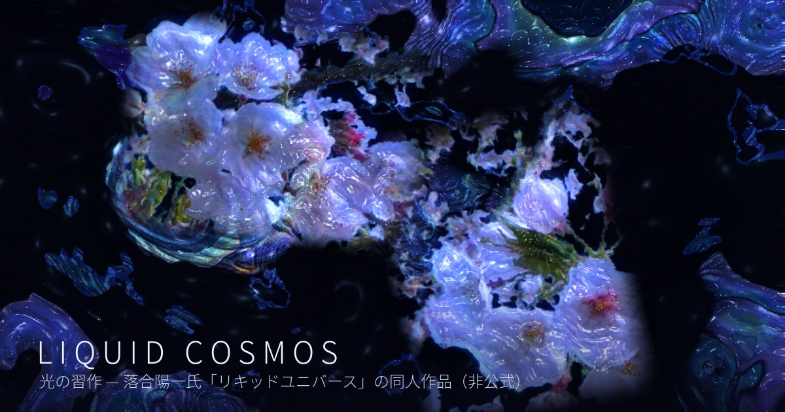
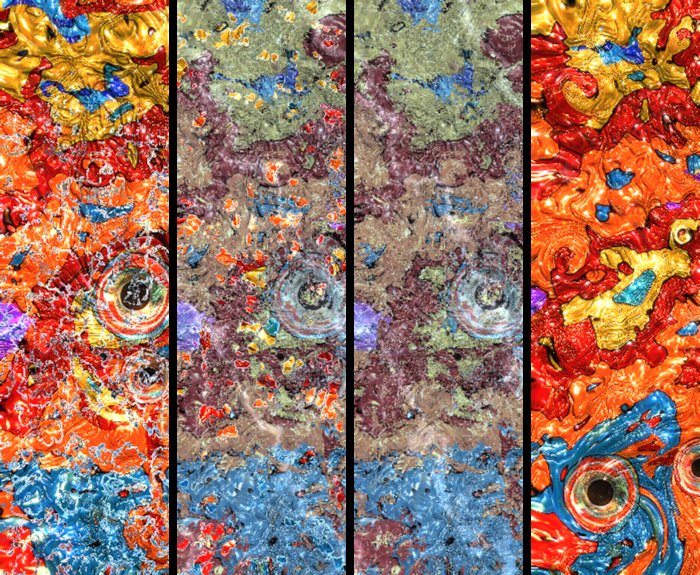

# LIQUID COSMOS — 光の習作

落合陽一氏の作品「リキッドユニバース」の**同人作品（ファンアート）**です。オリジナルではありません。
美術館で見た LED の柱の映像の質感を、ブラウザの WebGL シェーダーで再現しようとした個人の習作で、落合陽一氏および関係者とは一切関係ありません。

**▶ デモ：** https://unnameable-lab.github.io/unnameable-lab-liquid-cosmos/

## できること

- **9つのシーン**：夜桜・宵・螺鈿・緑金・虹油・陽光・紅・薄虹・モノクロ、と「移ろい」（自動で巡回）
- **渦**：点渦の物理（ビオ・サバール）で動く渦。触れ合うと泡のように合体し、ときどき弾ける（タップでも弾ける）
- **流体の移流**：模様は流れに運ばれ、引き伸ばされ、渦に巻き込まれる
- **液体の質感**：高さの地図から視差・影・照り返しを計算した、とろっとした液面
- **夜桜**：作者が撮影した桜の写真を液の下に沈め、屈折・色の染まり・照りを毎フレーム計算
- **❄ 凍る**：霜が結晶状に広がって全体が凍り、また縁から解ける
- **生き物**：アメンボ（足先のくぼみと波紋）、ホタル（点滅が互いにそろっていく、蔵本モデル）
- **音**：曲と、液から生まれる音（弾ける水音・合体の和音・凍る響き・ホタルの音）。東京湾の潮で調が移る。最初はオフ
- **触れる**：指でなぞると渦をかき混ぜる／マイクで手を叩くと波紋／スマホを傾けると流れる
- **潮・時刻**：東京湾（気象庁 東京の調和定数 M2・S2・K1・O1）の実際の潮と同期／日の出・日の入りでシーンが移る
- **柱モード・柱合会議**：実物と同じ縦長の柱、全シーンの柱を横一列（90度回転も可）
- **録画**：最大10分。X に載せやすい 9:16・MP4（対応ブラウザのみ）、音入りで保存
- **種**：同じ番号を入れると同じ始まりになる（`?seed=1234`）

## 使い方

`index.html` を開くだけで動きます（外部ライブラリなし・1ファイル）。
重い端末では自動で解像度を下げ、それでも重いときは軽量モードに切り替わります。
X などのアプリ内ブラウザでは録画を保存できないので、Chrome などで開いてください。

URL パラメータ：`?scene=yozakura|blue|morpho|gold|steam|sun|mito|pastel|mono` ／ `?pillar=1` ／ `?council=1` ／ `?seed=番号` ／ `?tide=tokyo` または `tokyo-fast`

## 素材

- 桜の写真：作者が撮影
- 音楽：作者が [Suno](https://suno.com) で作成（Made with Suno）

## 作った人

Unnameable Lab
